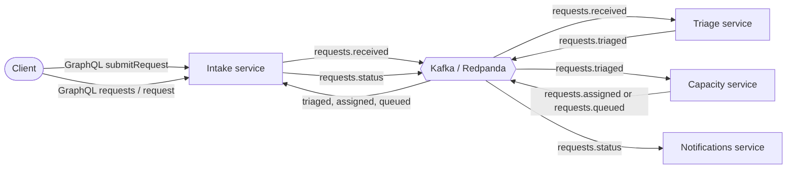

# Site Change Pipeline

Four small services that handle a website change request through events on Kafka, with a GraphQL API in front. A client's message comes in, one service works out what kind of request it is, another assigns it to the team member with the most room (or queues it), and a fourth tells the client, with no service calling another directly.

It comes from my own work running a web support queue, where the hard parts are exactly these: deciding what a request is, who has capacity, and not double-booking the same hours.

Personal project, built with Claude Code and reviewed by hand. It is a learning and portfolio build, not a production system.



## The flow
| Service | Owns | Listens to | Publishes |
|---|---|---|---|
| **Intake** (with the GraphQL API) | request records and status | `requests.triaged`, `requests.assigned`, `requests.queued` | `requests.received`, `requests.status` |
| **Triage** | classification rules | `requests.received` | `requests.triaged` |
| **Capacity** | each person's remaining hours | `requests.triaged` | `requests.assigned`, `requests.queued` |
| **Notifications** | nothing, only reacts | `requests.status` | none (logs a message) |

A request moves `received` then `triaged` then `assigned` or `queued`. Services only share topic names and event shapes ([src/events/types.ts](src/events/types.ts)), so a new service (say, an SLA timer) can be added without touching the others.

## Problems it solves on purpose
- **Two requests racing for the last hours:** capacity belongs to one service that handles events one at a time, so hours are never over-assigned (there is a test).
- **Events arriving out of order:** on a real broker, `assigned` can arrive before `triaged`. Intake never moves a status backwards (there is a test).
- **Swapping the broker:** services only know an `EventBus` interface. `InMemoryBus` runs tests and the one-process mode, and `KafkaBus` (kafkajs) runs the same code against Kafka or Redpanda.
- **Bad input:** GraphQL returns a clear `BAD_USER_INPUT` error for an empty client or a too-short message.

## Tests and CI
9 tests cover classification, the full flow, spreading work across people, queueing, the race, out-of-order events, input rules and the GraphQL API. GitHub Actions runs the type check, tests, build and `docker compose config`.

## Run it
One process, no Docker:
```bash
npm install
npm run dev:all        # GraphQL at http://localhost:4000/graphql
```
```bash
curl -s localhost:4000/graphql -H 'content-type: application/json' \
  -d '{"query":"mutation { submitRequest(client: \"Maple Dental\", message: \"Emails to our domain are bouncing back\") { id status } }"}'
curl -s localhost:4000/graphql -H 'content-type: application/json' \
  -d '{"query":"{ requests { client type priority status assignee } }"}'
```
The starting team is Priya (10 hours), Marcus (6) and Aiko (4).

With Kafka, as separate services:
```bash
docker compose up --build
```

## Honest status
- **Tested:** all service logic, the GraphQL API, the in-memory bus, and a real local run of `dev:all` with four requests (assigned, queued and notified as expected).
- **Not tested yet:** the `docker compose` stack against a live Redpanda broker. The Kafka code path uses kafkajs and the compose file is checked for syntax, but I have not run the full stack end to end. Treat that part as unverified until you run it.
- **Simplifications:** keyword-based triage, everything in memory, no retries, dead-letter topic or idempotency yet. Those would be the next steps for a real system.
